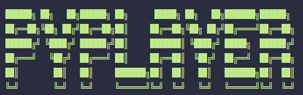
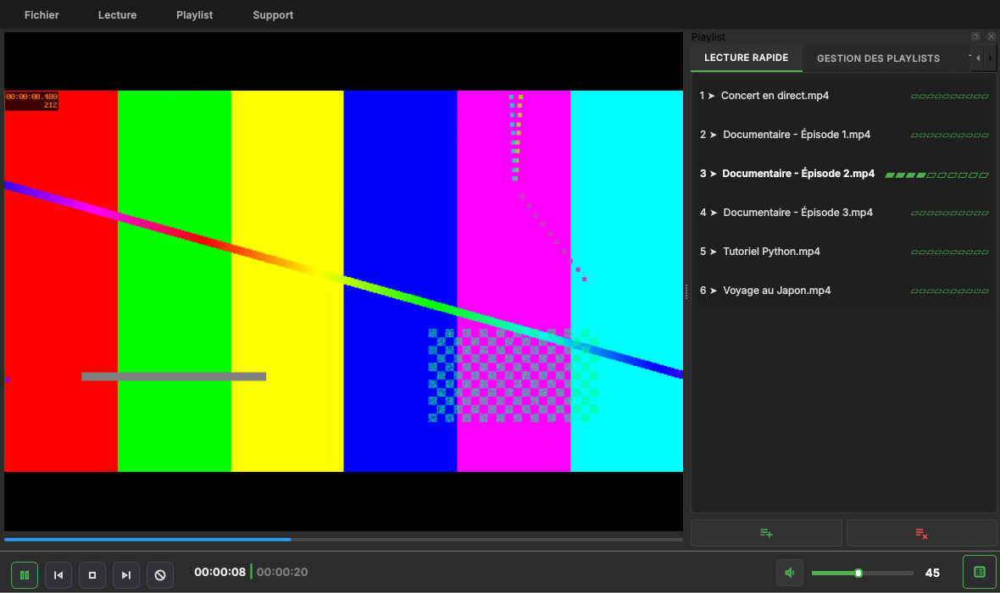
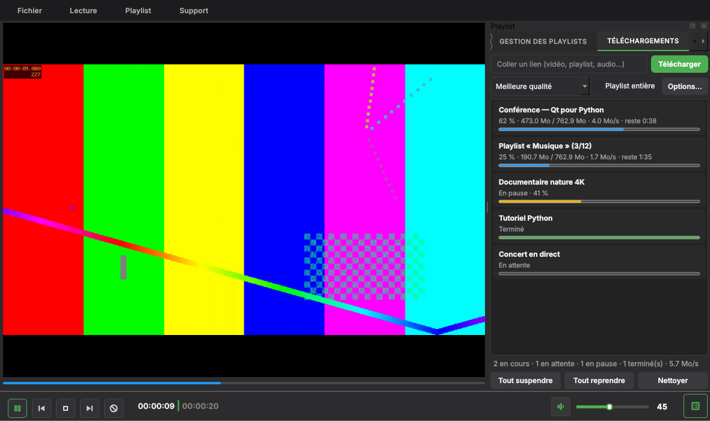

<div align="center">



**Lecteur vidéo et audio local, rapide et sobre — avec téléchargeur intégré.**
Écrit en Python avec PySide6 (Qt 6) et FFmpeg.

[](https://github.com/Joselma-Jemk/Py_player/actions/workflows/tests.yml)
[](https://github.com/Joselma-Jemk/Py_player/releases)


[](LICENSE)

[Installation](#installation) · [Fonctions](#fonctions) · [Téléchargements](#téléchargements) ·
[Ligne de commande](#ligne-de-commande) · [Raccourcis](#raccourcis) · [Développement](#développement)

</div>

<p align="center">
  
</p>

## Pourquoi PyPlayer

* **Sobre et rapide** : une interface sombre épurée, aucune publicité, aucun compte, aucune télémétrie.
* **Il se souvient de tout** : playlists persistantes, reprise de lecture fichier par fichier, fenêtre et réglages mémorisés.
* **Solide** : écritures atomiques, instantanés rotatifs, fichiers corrompus mis en quarantaine ; plus de 560 tests,
  dont des tests de propriétés (Hypothesis), de coupure brutale (`SIGKILL`) et de mutation.
* **Tout-en-un** : lit les fichiers locaux, les adresses réseau et les pages web (via yt-dlp), télécharge avec reprise
  automatique, et se pilote aussi depuis un terminal.
* **Fiable à installer** : binaires et installateur Windows publiés avec leurs sommes SHA-256 ; les mises à jour et
  les outils (yt-dlp, FFmpeg) sont **toujours vérifiés par SHA-256** avant d'être installés.

## Installation

### Windows — installateur (recommandé)

Téléchargez `pyplayer-<version>-windows-setup.exe` depuis les [releases](https://github.com/Joselma-Jemk/Py_player/releases)
et lancez-le. Sans droits administrateur par défaut, avec :

* raccourci du menu Démarrer et désinstalleur ;
* enregistrement dans « Ouvrir avec… » pour tous les formats audio et vidéo (le lecteur par défaut reste votre choix,
  dans les paramètres Windows) ;
* option **« Ajouter `pyplayer` au PATH »** (cochée par défaut, retirée proprement à la désinstallation) pour utiliser la
  [ligne de commande](#ligne-de-commande) depuis n'importe quel terminal.

### Binaire autonome (sans Python)

Chaque release contient un exécutable unique par système, avec son fichier de sommes SHA-256 :

| Système | Fichier |
|---|---|
| Windows | `pyplayer-<version>-windows-AMD64.exe` |
| Linux | `pyplayer-<version>-linux-x86_64` |

```bash
sha256sum -c SHA256SUMS-linux.txt                 # vérifier le téléchargement
chmod +x pyplayer-*-linux-x86_64
./pyplayer-*-linux-x86_64 self-install            # place « pyplayer » dans ~/.local/bin
```

### Depuis les sources

Prérequis : Python ≥ 3.10. Qt Multimedia utilise son backend FFmpeg, déjà embarqué dans les roues PySide6.

```bash
git clone https://github.com/Joselma-Jemk/Py_player.git && cd Py_player
pip install .                 # ajoutez ".[online]" pour embarquer yt-dlp ; ".[dev]" pour développer
pyplayer                      # ou : python -m pyplayer
```

## Fonctions

| | |
|---|---|
| **Lecture** | vidéo et audio (MP4, MKV, WebM, AVI, MOV, TS, FLAC, MP3, OGG, Opus…), adresses réseau, vitesse 0,25× → 4×, boucle A-B, « aller à l'instant », capture d'écran |
| **Barre de progression** | dessinée sur mesure, avec **miniatures de prévisualisation** au survol et marque de la boucle A-B |
| **Reprise** | position mémorisée pour chaque fichier (≥ 5 s, hors fin de média), reprise automatique à la réouverture |
| **Pistes** | choix de la piste audio ; sous-titres intégrés **et** externes (`.srt` / `.vtt`, chargés automatiquement), décalage, choix du périphérique de sortie |
| **Image** | ajuster / remplir / étirer, plein écran avec contrôles qui réapparaissent à la souris, toujours au premier plan, veille inhibée pendant la lecture |
| **Playlists** | plusieurs playlists persistantes, 4 modes (normal, boucle fichier, boucle liste, aléatoire sans répétition), tri naturel (`ep2` avant `ep10`) / nom / date / taille / durée, glisser-déposer, import/export M3U sans doublons, actualisation depuis le dossier source |
| **Informations** | clic droit → « Informations sur le média » : conteneur, pistes, codecs, débits, chapitres, métadonnées, pochette, empreinte SHA-256 (via ffprobe) |
| **Affichage à l'écran** | titre et état en surimpression discrète (pas de barre d'état) |
| **Confort** | fichiers récents, menus contextuels, touches multimédia, molette = volume, glisser-déposer de fichiers et dossiers |
| **Robustesse** | écriture atomique, 5 instantanés par playlist, quarantaine des fichiers corrompus, migration automatique de l'ancienne version |
| **Vie privée** | tout reste dans `~/.pyplayer` ; « Support → Réinitialiser PyPlayer… » efface les données au choix (jamais vos médias) |

### Ouvrir avec… et instance unique

* Un fichier ouvert depuis l'explorateur (ou `pyplayer film.mkv`) est lu immédiatement ; si PyPlayer est déjà ouvert, le
  fichier lui est transmis — jamais de seconde fenêtre.
* Ouvrir **un seul fichier** met aussi en file les médias du même dossier, dans l'ordre naturel : l'épisode suivant se
  lance tout seul (réglage `open_siblings` dans `settings.json`).
* **Linux** : copiez `packaging/pyplayer.desktop` dans `~/.local/share/applications/` pour apparaître dans « Ouvrir avec… ».

## Téléchargements

<p align="center">
  
</p>

L'onglet **Téléchargements** (`Ctrl+Maj+D`) s'appuie sur [yt-dlp](https://github.com/yt-dlp/yt-dlp) :

* file d'attente, vitesse, temps restant, pause / reprise / annulation, **reprise automatique** à la réouverture ;
* **playlists** dépliées vidéo par vidéo, avec sélection (`1-5,8`) et ordre inversé ;
* **options avancées** : qualité (ou format personnalisé), audio seul, sous-titres, SponsorBlock, limite de débit,
  cookies du navigateur, extrait, modèle de nom de fichier ;
* **chasse aux liens** : un lien de vidéo copié (navigateur, message) est proposé dans une bulle discrète
  (Télécharger / Lire / Ignorer) — désactivable ;
* **lecture intelligente** : une page web se lit directement ; pendant son téléchargement on regarde le flux, et dès
  que le fichier est complet la lecture **bascule sur la copie locale à la même position** ;
* les téléchargements terminés rejoignent la playlist « Téléchargements ».

**yt-dlp et FFmpeg** s'installent en un clic (Support → « Installer / mettre à jour yt-dlp », « Installer FFmpeg ») :
versions officielles de GitHub, **somme SHA-256 vérifiée**, rangées dans les données de PyPlayer (rien dans le système).
Sans FFmpeg, PyPlayer reste utilisable (fichier unique, qualité limitée) et le dit.

> Respectez les conditions d'utilisation des sites et le droit d'auteur : PyPlayer est un outil, pas une autorisation.

## Ligne de commande

La commande `pyplayer` télécharge sans ouvrir de fenêtre et démarre instantanément (Qt n'est même pas chargé). Elle
partage les réglages de l'application.

```bash
pyplayer download https://youtu.be/XXXX                     # une vidéo (alias : dl)
pyplayer dl -q 720p -o ~/Videos "lien1" "lien2" -j 4         # plusieurs liens, 4 en parallèle
pyplayer dl -a https://soundcloud.com/artiste/titre          # audio seul (mp3 ; -a m4a, -a opus)
pyplayer dl -p --items 1-5,8 "https://youtube.com/playlist?list=PL…"   # une partie d'une playlist
pyplayer dl -f liens.txt                                     # tous les liens d'un fichier
echo "copié : https://vimeo.com/123" | pyplayer dl -         # ou depuis l'entrée standard
pyplayer dl --subs fr,en --sponsorblock remove --rate-limit 2M "lien"
pyplayer dl --json "lien"                                    # une ligne JSON par événement (scripts)
pyplayer dl --resume                                         # reprend ce que Ctrl+C a interrompu
pyplayer dl --play "lien"                                    # ouvre PyPlayer sur le fichier téléchargé

pyplayer tools status | install [ytdlp|ffmpeg|all]          # outils : installation vérifiée (SHA-256)
pyplayer update [--install]                                  # cherche / installe une nouvelle version
pyplayer self-install                                        # Linux/macOS : place « pyplayer » dans ~/.local/bin
```

Lecture :

```text
pyplayer [options] [fichiers | dossiers | playlists .m3u/.m3u8/.pls | URL …]

  -a, --enqueue        ajoute à la playlist active au lieu de lire tout de suite
  -n, --new-instance   n'utilise pas la fenêtre déjà ouverte
      --fullscreen     démarre en plein écran
      --debug          journaux détaillés
  -v, --version
```

Codes de sortie du téléchargeur : `0` succès · `1` au moins un échec · `2` usage invalide · `3` yt-dlp absent ·
`130` interrompu. Pour ouvrir un dossier nommé `download` ou `tools`, écrivez `pyplayer ./download`.

## Mises à jour

PyPlayer vérifie discrètement une fois par jour (désactivable : Support → « Vérifier les mises à jour automatiquement ») s'il existe
une release plus récente de ce dépôt. Le fichier est **comparé à la somme SHA-256 publiée** avant tout remplacement :
installateur silencieux sous Windows, remplacement atomique sous Linux. Cette vérification protège contre une
corruption ou une altération en transit ; elle ne protège pas d'une release elle-même compromise.

## Raccourcis

| Touche | Action | Touche | Action |
|---|---|---|---|
| `Espace` / clic | lecture / pause | `Ctrl+O` | ajouter des fichiers |
| `←` `→` (`Maj` : ±60 s) | ±10 s | `Ctrl+Maj+O` | ouvrir et lire un fichier |
| `↑` `↓` / molette | volume | `Ctrl+D` | ajouter un dossier |
| `M` | muet | `Ctrl+U` | ouvrir une adresse réseau |
| `[` `]` `⌫` | plus lent / plus rapide / normal | `Ctrl+N` | nouvelle playlist |
| `L` | boucle A-B | `Ctrl+P` | afficher/masquer la liste |
| `Ctrl+G` | aller à l'instant | `F2` / `F5` | renommer / actualiser la playlist |
| `A` / `V` | piste audio / sous-titres suivants | `Alt+↑` `Alt+↓` | déplacer dans la liste |
| `Z` / `X` | sous-titres −/+ 0,1 s | `Suppr` | retirer de la liste |
| `S` | capture d'écran | `Ctrl+I` | informations sur le média |
| `F`, `F11`, double-clic | plein écran | `Ctrl+←` / `Ctrl+→` | précédent / suivant |
| `Échap` | quitter le plein écran | `Ctrl+Maj+D` | onglet Téléchargements |
| `F1` | aide | | |

## Données utilisateur

Dans `~/.pyplayer` (surchargeable avec la variable `PYPLAYER_HOME`) :

```
playlists/<nom>-<id8>.json    une playlist par fichier
playlists/backups/            5 instantanés par playlist (jamais rechargés comme playlists)
settings.json                 volume, fenêtre, récents, options
resume.json                   positions de reprise (1 000 entrées max)
downloads.json                file de téléchargements (reprise automatique)
tools/                        yt-dlp et FFmpeg installés par PyPlayer
pyplayer.log                  journal tournant
```

## Architecture

```
src/pyplayer/
├── __main__.py          point d'entrée : CLI ou GUI, instance unique, gestion des erreurs
├── cli.py               ligne de commande (download · tools · update · self-install), sans Qt
├── api/                 logique métier — AUCUNE dépendance à Qt (testable seule)
│   ├── playlist.py · manager.py · resume.py · settings.py · playback.py · video.py
│   ├── media.py · m3u.py · subtitles.py · mediainfo.py        formats, listes, métadonnées (ffprobe)
│   ├── online.py · downloads.py · links.py                    yt-dlp, file d'attente, chasse aux liens
│   ├── fetch.py · tools.py · updater.py                       téléchargements vérifiés (SHA-256), outils, mises à jour
│   └── reset.py · io_utils.py · paths.py · logging_setup.py
└── ui/                  interface Qt
    ├── main_window.py   fenêtre et orchestration de la lecture
    ├── widget/          lecteur, barre de progression, menus, panneaux (playlists, téléchargements), surimpression
    └── dialogs.py · theme.py · power.py · single_instance.py
packaging/               Inno Setup (installateur), raccourci Linux, shim pyplayer.cmd
tools/                   build Nuitka, benchmark, test de mutation, captures d'écran
```

Principes : la vidéo courante est référencée **par objet** (jamais par index ou par nom) ; les playlists ne sont
réécrites que lorsqu'elles changent ; la position est enregistrée pour le média **réellement chargé** ; yt-dlp tourne
**dans un sous-processus par téléchargement** (pause = arrêt, reprise par fichier `.part`) ; rien n'est téléchargé sans
vérification SHA-256 ni hors des hôtes GitHub autorisés.

## Développement

```bash
pip install -e ".[dev]"
QT_QPA_PLATFORM=offscreen pytest            # suite complète (hors écran, vrais médias générés par ffmpeg)
PYPLAYER_THOROUGH=1 pytest                  # ×10 exemples pour les tests à base de propriétés
pytest --cov=pyplayer                       # couverture
python -m pyflakes src                      # analyse statique
python tools/mutation_check.py              # test de mutation de l'API
python tools/benchmark.py                   # mémoire et temps (voir docs/PERFORMANCE.md)
python tools/screenshots.py                 # régénère les captures de ce README
python tools/build_nuitka.py                # binaire autonome -> dist/ (nécessite ".[build]")
```

Nuitka ne compile pas d'un système à l'autre. Le workflow [`release.yml`](.github/workflows/release.yml) construit
Linux et Windows : `git tag vX.Y.Z && git push origin vX.Y.Z` lance les tests, compile, vérifie chaque binaire, construit
l'installateur Windows, teste son installation/désinstallation silencieuses et publie la release (notes tirées de
[`CHANGELOG.md`](CHANGELOG.md)).

Pour aller plus loin : [`docs/TESTING.md`](docs/TESTING.md) (stratégie de tests),
[`docs/PERFORMANCE.md`](docs/PERFORMANCE.md) (mesures), [`docs/ROADMAP.md`](docs/ROADMAP.md) (idées et sources),
[`docs/AUDIT_PYPLAYER.md`](docs/AUDIT_PYPLAYER.md) (audit initial et statut de chaque correction),
[`CONTRIBUTING.md`](CONTRIBUTING.md) et [`SECURITY.md`](SECURITY.md).

## Limites connues

* Testé sous Linux et Windows (CI) ; macOS n'a pas de binaire publié.
* Le rendu et le son réels dépendent de votre machine : la CI vérifie la logique, pas l'affichage.
* Le backend Qt Multimedia ne remplace pas libmpv pour les formats les plus exotiques (voir la feuille de route).

## Licence

[MIT](LICENSE) © 2025 Josias KOUTCHANOU
